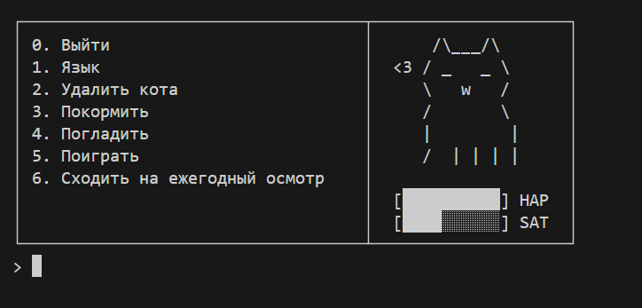

# CAT game *v0.1.1b*

тестовая игра-тамагочи про котика.

## Что есть в игре?
- Оффлайн прогресс - пока вас нет в игре, котик теряет очки счастья и голода
- Сохранение котика в файл
- Играйте, кормите своего котика и он будет счастлив
- **Несколько секреток!** попробуйте найти их все
- ASCII графика

### changelog: 
#### fix
- При попытке воскресить живого котика или котика в коробке,  
игра вылетала с фатальной ошибкой [GitHub #1](https://github.com/CHELOBARYK/phpstudy/issues/1)
- Небольшие изменения в UI
- перевод на английский и русский теперь 100%
#### new features
- каждый месяц после создания котик празднует день рождения
- можно сменить коту имя

## ЗАПУСК
1. Скачайте zip-файл со [страницы релизов](https://github.com/CHELOBARYK/phpstudy/releases/latest)
2. Распакуйте в любую папку, неважно куда
3. Нажмите `Play.bat`, откроется командная строка
4. Играйте :3

### ДЛЯ РАЗРАБОТЧИКОВ (локальный запуск)
<!-- кли версия -->
1. Клонируйте репозиторий
2. Запустите `composer install`
3. Переименуйте `.env.example` в `.env`
4. Вставьте свои значения
5. запустите `php bin/play.php` в терминале

## СТЕК и технологии
- PHP 8.5
- Composer
- PHPUnit
- JSON

#
- Все баги или идеи присылайте мне в тг или в GitHub Issues [GitHub Issues](https://github.com/CHELOBARYK/phpstudy/issues)
- Ссылка на канал с обновлениями: [*тык*](https://t.me/catGame_updates)