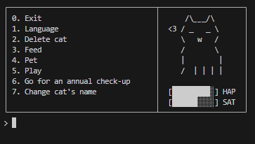

# CAT game *v0.1.1b*

A test Tamagotchi-style game featuring a cat.

## What’s in the game? - Offline progress: while you’re away from the game, your cat loses happiness and hunger points
- Save your cat to a file
- Play with and feed your cat to keep it happy
- **Several secrets!** Try to find them all
- ASCII graphics

### Changelog:
#### Fixes
- Fixed a fatal error that caused the game to crash when attempting to revive a cat that was already alive or inside a box [GitHub #1](https://github.com/CHELOBARYK/phpstudy/issues/1)
- Minor UI adjustments
- Translation to English and Russian is now 100% complete
#### New features
- Your cat celebrates its birthday every month from the date it was created
- You can change your cat's name

## HOW TO RUN
1. Download the zip file from the [releases page](https://github.com/CHELOBARYK/phpstudy/releases/latest)
2. Extract it to any folder of your choice
3. Run `Play.bat` to open the command line
4. Enjoy the game! :3

### FOR DEVELOPERS (running locally)
1. Clone the repository
2. Run `composer install`
3. Rename `.env.example` to `.env`
4. Enter your own values
5. Run `php bin/play.php` in your terminal

## Tech Stack
- PHP 8.4+
- Composer
- PHPUnit
- JSON

#
- Please report any bugs or share your ideas via Telegram or by opening a GitHub Issue: [GitHub Issues](https://github.com/CHELOBARYK/phpstudy/issues)
- Link to the updates channel: [*click here*](https://t.me/catGame_updates)